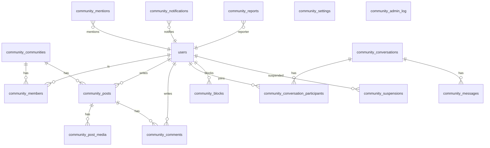

# Community

Communities, a feed, comments, mentions, notifications and 1-1 chat for signed-in people. Module code: `src/modules/community`. Tables: `community_*`.

Pages are signed-in and personal, so they are dynamic (route group `(community)`, own slim shell). The public site stays static.

## Where things are

| Address | What |
|---|---|
| `/community` | Feed of the default community |
| `/community/<slug>` | Feed of one community: composer, join, switcher |
| `/community/<slug>/post/<id>` | A post with its comments |
| `/community/communities` | Listed communities with Join |
| `/community/messages`, `/messages/<id>`, `/messages/new?user=<id>` | Conversations |
| `/community/notifications` | Mentions and comments on your posts |
| `/community/u/<userId>` | Someone else's profile: Posts, Comments, Mentions, Message, Block / Report |
| `/account/community?section=` | Your own profile tab: Posts, Comments, Mentions, Conversations (a **Community** entry in the account menu) |
| `/community/moderate` | Moderators: Members and Reports of their communities |
| `/admin/communities/...` | SuperAdmin control panel (Overview, Communities, Moderation, Content, Suspensions, Settings; Members per community) |

## Folder structure

```
src/modules/community/
  schema.ts            Drizzle tables (re-exported in src/db/schema.ts)
  strings.ts           every word the module shows (translation later)
  lib/                 pure code: constants, cursor, text + mention tokens, browser data layer (client.ts)
  server/              services, one file per area. permissions.ts is the only place that decides who may do what
    api.ts             wrapper for route handlers (session, same-origin check, viewer, typed errors)
    context.ts         viewer, community, membership, ensureDefaultMembership
    posts, comments, mentions, notifications, chat, communities, safety, rate, uploads, profile, admin, settings, people
  hooks/use-polling.ts the only polling code
  components/          client and server components, community.css
  admin/               control panel and moderator panels, admin.css
  __tests__/           pure.test.ts (permissions, cursor, text) and services.test.ts (real SQL on PGlite)
src/app/(community)/   thin pages          src/app/api/community/   member API          src/app/api/admin/community/   admin API
```

## Rich content publishing (SuperAdmin only)

- **Rich posts:** a post built from the Landing Pages blocks (all of them: hero, hero with image, call to action, buttons, form, countdown, session, video, pricing, FAQ and more). Stored in `community_posts` (`kind = 'rich'`, `title`, `blocks` JSON, the feed excerpt in `body`), so likes, comments, pinning, comments off, hiding and deleting work as for any post. Blocks are cleaned against the Landing schema on save; unknown types are dropped. Drawn by `components/rich-body.tsx` with the landing renderer, so a block looks the same in both places.
- **Where to build:** `/admin/communities/posts` is the main place (list, filters, pin, publish, comments on or off, delete) and `/admin/communities/posts/<id>` is the builder (`admin/rich-builder.tsx`, derived from the landing builder: palette, canvas, inspector, brand check). In the feed, the SuperAdmin's composer has **Build a rich post**, which opens the builder with the community and category already chosen. Drafts are visible only to the SuperAdmin (preview at the post address).
- **In the feed:** a snippet with the title, the excerpt, chips for what is inside (Form, Countdown, Live session, Video...), a picture and the like and comment counts. On click, the built page opens with the comments below.
- **Feed looks (themes):** each rich post picks one of five, each a combination of brand colours and a layout, drawn from brand tokens only (`components/community.css`, `.cm-rich--<theme>`): **Ink** (dark band, red edge, picture right), **Paper** (white, ink frame, picture left), **Signal** (solid red, white type, framed picture), **Tint** (soft red, wide picture on top), **Frame** (light grey, ink border, large title, framed square picture). The builder shows a live preview. To add a theme: add its key to `THEMES` in `lib/rich.ts` and a `.cm-rich--<key>` block that sets the variables `--rb --rf --rm --rl --ra --rbo --rpb --rpf`.
- **Snippet picture:** the SuperAdmin can set a **featured picture** and/or a **featured video link** in the builder. Otherwise the feed uses the first visual block of the post: an image, hero image, gallery or cards picture, or a video block (its cover image, or the YouTube thumbnail). A video gets a play mark. YouTube thumbnails come from `i.ytimg.com`; Vimeo, Loom and MP4 need a cover image.
- **Categories:** `/admin/communities/<id>/categories`. Published categories are tabs after "All" (`?category=<slug>`). Members choose one when posting; the author or the SuperAdmin can change it later. Deleting a category keeps its posts.
- **Sorting:** each category and the "All" feed (community edit page) has a default rule: Default (latest activity), New, Top (most liked). Pinned posts come first under every rule. Members can switch with the sort menu (`?sort=`), which also offers Unread (posts you have not opened; tracked in `community_post_reads`).
- **Pin:** the SuperAdmin pins and unpins any published post; hiding or deleting unpins.
- **Post menu:** Edit (the author, or the SuperAdmin on any text post), Edit in the builder (rich posts), Copy link, Change category, Pin or Unpin, Turn comments off or on, Hide or Show again, Report, Ban author from this community, Delete.
- **Migrations:** `drizzle/0008_community_rich_posts.sql` (categories, post columns, reads table, indexes, and a backfill of `last_activity_at`) and `drizzle/0009_community_snippet_themes.sql` (`theme` and `featured` on posts).

## Public communities

Each community has an **Access** setting (Admin > Communities > edit): **Private** (the default, how every community worked until now) or **Public**. The column is `community_communities.access` (migration `0011_community_public_access.sql`, additive, default `private`, so old code keeps working while it rolls out).

| | Private | Public |
|---|---|---|
| Who reads | signed-in members (hidden ones: members only) | anyone, no account, for the **published rich posts** |
| Who posts | members | the SuperAdmin only (rich posts); members cannot post |
| Who comments | members | any signed-in person; an **open** community adds them as a member with their first comment, a **closed** one needs an existing membership; banned, suspended, paused and archived rules still apply |
| Likes | members | same as comments |
| Where it shows | `/community/<slug>` | also `/c/<slug>/<id>` and Landing Pages blocks |

What leaves the server for a visitor is decided in one file, `server/public.ts`: only `kind = 'rich'`, `status = 'published'`, in a community with `access = 'public'`. Drafts, hidden or deleted posts, plain member posts and everything in private communities answer "not found". A public community must be **listed** and the default community cannot be public. Turning a community back to Private takes the public face away at once. Commenters' names and avatars are public on a public post.

- **Public post page** `/c/<community>/<id>` (`src/app/(site)/c/...`): static and cached (`revalidate = 300`, no cookies). Title, date, the post's blocks, then `components/public-comments.tsx`, which runs in the browser: it asks `/api/public/community/me` who is looking, then loads the comments (`/api/public/community/posts/<id>/comments` for visitors, the member API for signed-in people). Visitors read and see "Sign in to comment"; signed-in people get the comment box. Comments are never part of the static HTML.
- **Landing blocks** (group *Community*): **Featured post** (a community and optional category; the pinned, newest or most liked post, or a chosen one; optional date range) and **Posts feed** (community, category, number of posts 1 to 24, order newest / most liked / most discussed, date range, pinned first, one or two columns, optional button). Read from the database when the page is built, so the page stays static. Cards use the post's own theme (Ink, Paper, Signal, Tint, Frame). The category list is the "tag": published categories of the community. These blocks are not offered inside rich posts.
- **Instant refresh:** publishing, saving, pinning, hiding or deleting a post, and changing a community, call `refreshPublic()` (`server/refresh.ts`), which revalidates every landing page and the post page. The 5 minute timer is the safety net.
- **Migrate before you deploy:** `drizzle/0011` adds the column the new code selects, so run `npm run db:migrate` against production first, then merge.

## Data model



Mentions and reports point at posts, comments, messages or users by `source_type` / `target_type` plus an id, not by foreign key. Details and column notes are in `schema.ts`.

## Migrations

Four files, in order: `drizzle/0006_community_module.sql` (all tables, indexes and the idempotent seed: default community "Community" and the settings row) `drizzle/0007_community_likes.sql` (likes table and `like_count` columns) `drizzle/0008_community_rich_posts.sql` (categories, rich posts, pinning, reads) and `drizzle/0009_community_snippet_themes.sql` (snippet theme and featured media).

```bash
# local: in-memory Postgres, applies drizzle/*.sql on start (see scripts/local-db/README.md)
node scripts/local-db/server.mjs
# production, deliberately, by the owner, with DATABASE_URL pointing at production:
npm run db:migrate
```

`.env.local` in a checkout points at Neon. Do not run `db:migrate` from a checkout unless production is the intention. The seed uses `WHERE NOT EXISTS` and `ON CONFLICT DO NOTHING`, so running it twice changes nothing. Lazy membership: the first visit to Community calls `ensureDefaultMembership(userId)`; nobody is mass-inserted.

## Tests

```bash
npm run test:community   # 27 tests: permissions, cursors, text/mention parsing, and the services against real SQL (PGlite)
```

## How polling works

`hooks/use-polling.ts`: `usePolling(fn, { intervalMs, enabled, key })`. It pauses while the tab is hidden and makes one catch-up call when it is visible again, waits while offline, adds +/- 20% jitter, backs off exponentially after errors (to 60 s) and resets on success, and aborts the request in flight on unmount or when `key` changes.

| Surface | Interval | Call |
|---|---|---|
| Feed | 15 s | `GET /api/community/<slug>/posts/updates?after=<cursor>` returns `{ newCount, newestCursor }` |
| Post comments | 10 s | `GET /api/community/posts/<id>/comments/updates?after=<cursor>` |
| Bell | 30 s | `GET /api/community/notifications/unread-count` |
| Messages badge | 30 s | `GET /api/community/conversations/unread-count` |
| Open conversation | 10 s | `GET /api/community/conversations/<id>/messages?after=<cursor>` |
| Conversation list | 30 s | `GET /api/community/conversations` |

Cursors are `<createdAtIso>_<id>`, ordered by `(created_at, id)`. `created_at` is always written from the app clock (milliseconds) so a cursor never repeats or skips a row. The page never inserts new posts by itself: it shows a "N new posts" pill. Own items appear at once (optimistic) and do not move the "newest seen" cursor, so a post that landed earlier from someone else is not skipped. `lib/client.ts` is the only browser data layer; swapping polling for a managed realtime service means changing `usePolling` call sites inside `Feed`, `CommentSection`, `ConversationThread` and the badges.

## Permission matrix

Roles: **SuperAdmin** is the `owner` role (permission `community.manage`). **Moderator** and **Member** are per community. **Visitor** is signed in, not a member. All rules are pure functions in `server/permissions.ts` and are unit tested.

| Action | Anonymous | Visitor | Member | Moderator | SuperAdmin |
|---|---|---|---|---|---|
| View a listed community | no | yes | yes | yes | yes |
| View a hidden community | no | no | yes | yes | yes |
| Join an open community | no | yes | n/a | n/a | yes |
| Post or comment | no | no | yes | yes | yes |
| Edit or delete own post or comment | no | no | yes | yes | yes |
| Hide or delete others' content | no | no | no | yes (own community) | yes (all) |
| Ban or unban | no | no | no | yes (own community) | yes (all) |
| Assign moderators | no | no | no | no | yes |
| Create, edit, archive communities | no | no | no | no | yes |
| Settings, suspensions, global queue | no | no | no | no | yes |
| Direct message | no | yes | yes | yes | yes (unless blocked or suspended) |

Also: banned members are read only in that community. An archived community is read only for everyone; only the SuperAdmin can still hide or delete. `posting_paused` stops posts and comments everywhere (edits, deletes and messages still work). A suspended person is read only across the module. Messages are private to the two people; nobody else, admins included, can read them. A reported message is copied into the report, and only that copy reaches the SuperAdmin.

## Safety and limits

- Plain text only. Bodies render as React text nodes; links get `rel="noopener noreferrer nofollow ugc"` and `target="_blank"`. There is no `dangerouslySetInnerHTML`.
- Uploads: the type is checked by content with `sharp`, then every image is re-encoded to WebP (this drops EXIF, GPS included), max 2000 px, stored under `images/community/` with a server-chosen key. Limits come from settings (count, MB).
- Rate limits count the person's own rows in the window (posts and comments per hour, messages per minute) and answer HTTP 429 with `retryAfter`. The SuperAdmin is exempt. Settings are cached for 30 seconds.
- Duplicate submits: every create call carries a client `requestId`; a unique index per author makes a repeat return the first item.
- Counters (`comment_count`) change in the same SQL statement as the comment.

## How to extend

- **More reactions:** likes exist (`community_likes`, `like_count` on posts and comments, `server/likes.ts`, `POST /api/community/likes`). For other kinds add a `kind` column to `community_likes`, widen the unique index to include it and keep one counter per kind.
- **Realtime:** replace the body of `usePolling` call sites with a subscription (keep the same callbacks). The `updates` endpoints can stay as the catch-up path.
- **Regions:** `community_communities.region_id` exists and is unused. Filter `listCommunities` by the viewer's region, and add the field to the admin form.
- **Group chat:** conversations already use a participants table. Allow `type = 'group'`, drop the `dm_key` check for it, and extend `listConversations` to show several people.
- **Translation:** copy `strings.ts` per locale and choose by locale. Dates already use the viewer's browser locale.
- **Emails and push:** not built. Notifications are rows in `community_notifications`; a sender would read them.
