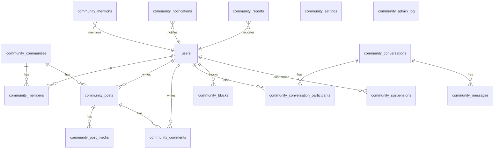

# Community

Communities, a feed, comments, mentions, notifications and 1-1 chat for signed-in people. Module code: `src/modules/community`. Tables: `community_*`.

Pages are signed-in and personal, so they are dynamic (route group `(community)`, own slim shell). The public site stays static.

## Where things are

| Address | What |
|---|---|
| `/community` | Feed of the default community |
| `/community/<slug>` | Feed of one community: composer, join, switcher |
| `/community/<slug>/post/<id>` | A post with its comments |
| `/community/communities` | Listed communities with Join |
| `/community/messages`, `/messages/<id>`, `/messages/new?user=<id>` | Conversations |
| `/community/notifications` | Mentions and comments on your posts |
| `/community/u/<userId>` | Someone else's profile: Posts, Comments, Mentions, Message, Block / Report |
| `/account/community?section=` | Your own profile tab: Posts, Comments, Mentions, Conversations (a **Community** entry in the account menu) |
| `/community/moderate` | Moderators: Members and Reports of their communities |
| `/admin/communities/...` | SuperAdmin control panel (Overview, Communities, Moderation, Content, Suspensions, Settings; Members per community) |

## Folder structure

```
src/modules/community/
  schema.ts            Drizzle tables (re-exported in src/db/schema.ts)
  strings.ts           every word the module shows (translation later)
  lib/                 pure code: constants, cursor, text + mention tokens, browser data layer (client.ts)
  server/              services, one file per area. permissions.ts is the only place that decides who may do what
    api.ts             wrapper for route handlers (session, same-origin check, viewer, typed errors)
    context.ts         viewer, community, membership, ensureDefaultMembership
    posts, comments, mentions, notifications, chat, communities, safety, rate, uploads, profile, admin, settings, people
  hooks/use-polling.ts the only polling code
  components/          client and server components, community.css
  admin/               control panel and moderator panels, admin.css
  __tests__/           pure.test.ts (permissions, cursor, text) and services.test.ts (real SQL on PGlite)
src/app/(community)/   thin pages          src/app/api/community/   member API          src/app/api/admin/community/   admin API
```

## Data model



Mentions and reports point at posts, comments, messages or users by `source_type` / `target_type` plus an id, not by foreign key. Details and column notes are in `schema.ts`.

## Migrations

One file: `drizzle/0006_community_module.sql` (all tables, indexes and the idempotent seed: default community "Community" and the settings row).

```bash
# local: in-memory Postgres, applies drizzle/*.sql on start (see scripts/local-db/README.md)
node scripts/local-db/server.mjs
# production, deliberately, by the owner, with DATABASE_URL pointing at production:
npm run db:migrate
```

`.env.local` in a checkout points at Neon. Do not run `db:migrate` from a checkout unless production is the intention. The seed uses `WHERE NOT EXISTS` and `ON CONFLICT DO NOTHING`, so running it twice changes nothing. Lazy membership: the first visit to Community calls `ensureDefaultMembership(userId)`; nobody is mass-inserted.

## Tests

```bash
npm run test:community   # 21 tests: permissions, cursors, text/mention parsing, and the services against real SQL (PGlite)
```

## How polling works

`hooks/use-polling.ts`: `usePolling(fn, { intervalMs, enabled, key })`. It pauses while the tab is hidden and makes one catch-up call when it is visible again, waits while offline, adds +/- 20% jitter, backs off exponentially after errors (to 60 s) and resets on success, and aborts the request in flight on unmount or when `key` changes.

| Surface | Interval | Call |
|---|---|---|
| Feed | 15 s | `GET /api/community/<slug>/posts/updates?after=<cursor>` returns `{ newCount, newestCursor }` |
| Post comments | 10 s | `GET /api/community/posts/<id>/comments/updates?after=<cursor>` |
| Bell | 30 s | `GET /api/community/notifications/unread-count` |
| Messages badge | 30 s | `GET /api/community/conversations/unread-count` |
| Open conversation | 10 s | `GET /api/community/conversations/<id>/messages?after=<cursor>` |
| Conversation list | 30 s | `GET /api/community/conversations` |

Cursors are `<createdAtIso>_<id>`, ordered by `(created_at, id)`. `created_at` is always written from the app clock (milliseconds) so a cursor never repeats or skips a row. The page never inserts new posts by itself: it shows a "N new posts" pill. Own items appear at once (optimistic) and do not move the "newest seen" cursor, so a post that landed earlier from someone else is not skipped. `lib/client.ts` is the only browser data layer; swapping polling for a managed realtime service means changing `usePolling` call sites inside `Feed`, `CommentSection`, `ConversationThread` and the badges.

## Permission matrix

Roles: **SuperAdmin** is the `owner` role (permission `community.manage`). **Moderator** and **Member** are per community. **Visitor** is signed in, not a member. All rules are pure functions in `server/permissions.ts` and are unit tested.

| Action | Anonymous | Visitor | Member | Moderator | SuperAdmin |
|---|---|---|---|---|---|
| View a listed community | no | yes | yes | yes | yes |
| View a hidden community | no | no | yes | yes | yes |
| Join an open community | no | yes | n/a | n/a | yes |
| Post or comment | no | no | yes | yes | yes |
| Edit or delete own post or comment | no | no | yes | yes | yes |
| Hide or delete others' content | no | no | no | yes (own community) | yes (all) |
| Ban or unban | no | no | no | yes (own community) | yes (all) |
| Assign moderators | no | no | no | no | yes |
| Create, edit, archive communities | no | no | no | no | yes |
| Settings, suspensions, global queue | no | no | no | no | yes |
| Direct message | no | yes | yes | yes | yes (unless blocked or suspended) |

Also: banned members are read only in that community. An archived community is read only for everyone; only the SuperAdmin can still hide or delete. `posting_paused` stops posts and comments everywhere (edits, deletes and messages still work). A suspended person is read only across the module. Messages are private to the two people; nobody else, admins included, can read them. A reported message is copied into the report, and only that copy reaches the SuperAdmin.

## Safety and limits

- Plain text only. Bodies render as React text nodes; links get `rel="noopener noreferrer nofollow ugc"` and `target="_blank"`. There is no `dangerouslySetInnerHTML`.
- Uploads: the type is checked by content with `sharp`, then every image is re-encoded to WebP (this drops EXIF, GPS included), max 2000 px, stored under `images/community/` with a server-chosen key. Limits come from settings (count, MB).
- Rate limits count the person's own rows in the window (posts and comments per hour, messages per minute) and answer HTTP 429 with `retryAfter`. The SuperAdmin is exempt. Settings are cached for 30 seconds.
- Duplicate submits: every create call carries a client `requestId`; a unique index per author makes a repeat return the first item.
- Counters (`comment_count`) change in the same SQL statement as the comment.

## How to extend

- **Likes:** add `community_reactions (id, user_id, target_type, target_id, kind, created_at)` with a unique `(user_id, target_type, target_id)`, a `like_count` on posts and comments updated in one CTE like `comment_count`, one route `POST/DELETE /api/community/reactions`, and a button in `PostCard` and `CommentItem`. Add the viewer's own flag to the feed query as a `left join`, not a second query per post.
- **Realtime:** replace the body of `usePolling` call sites with a subscription (keep the same callbacks). The `updates` endpoints can stay as the catch-up path.
- **Regions:** `community_communities.region_id` exists and is unused. Filter `listCommunities` by the viewer's region, and add the field to the admin form.
- **Group chat:** conversations already use a participants table. Allow `type = 'group'`, drop the `dm_key` check for it, and extend `listConversations` to show several people.
- **Translation:** copy `strings.ts` per locale and choose by locale. Dates already use the viewer's browser locale.
- **Emails and push:** not built. Notifications are rows in `community_notifications`; a sender would read them.
